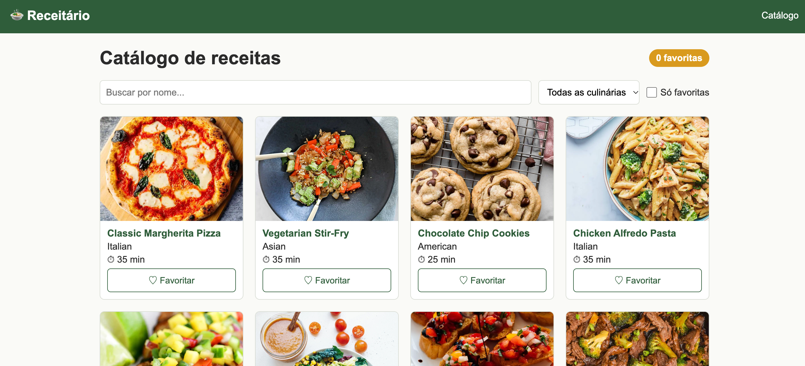

# 🍲 Receitário

Catálogo de receitas feito em **React + Vite + TypeScript**, consumindo a API pública da [DummyJSON](https://dummyjson.com/docs/recipes).
Checkpoint 5 de Frontend, FIAP, 2º semestre de ADS.

## Integrantes

| Nome | RM |
|------|----|
| Lucas Kaftan | RM571302 |
| João Carlos Lopes | RM568952 |

## Deploy

🔗 https://cp5-frontend-beta.vercel.app/

## Tela do catálogo



## Funcionalidades

- **Catálogo (`/`)**: grid de cards com imagem, nome, culinária e tempo total (preparo + cozimento), busca por nome, filtro por culinária (montado a partir dos dados da API) botão de favoritar com contador "N favoritas" e opção para mostrar só as favoritas.
- **Detalhe (`/receitas/:id`)**: imagem, ingredientes, modo de preparo e tempos, com mensagem quando a receita não existe (erro 404 da API).
- **404 (`*`)**: mensagem de página não encontrada e link de volta ao catálogo.

## Como rodar

```bash
npm install
npm run dev
```

Build de produção:

```bash
npm run build
```

## Estrutura

```
src/
├── components/   Header, Footer, Layout e RecipeCard
├── pages/        Catalogo, Detalhe e NaoEncontrada
├── types/        interfaces Recipe e RecipesResponse
├── App.tsx       rotas
└── main.tsx      entrada do app
```
